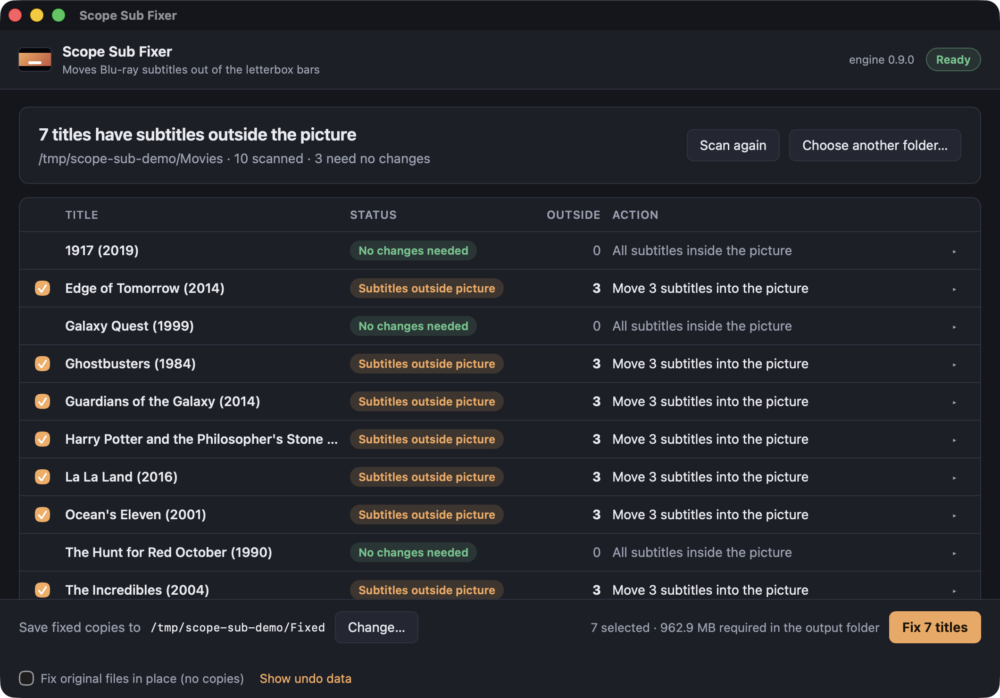

# Scope Sub Fixer

Some Blu-rays put their subtitles in the black letterbox bar below the picture.
On a TV the bar is visible, so this works. On a scope (2.35–2.40:1) projection
screen the bars fall outside the screen, and the subtitles cannot be seen.

Scope Sub Fixer finds these subtitles in MKV files and moves them up into the
picture. It is for people who watch films on a scope screen.



It comes as a desktop app and as a command-line tool, `scope-sub`. Both use the
same engine.

## What it does to a file

A PGS subtitle is an image with an x and y position. The tool changes those
positions and nothing else. It does not re-encode, re-time or resize anything.

When the tool is not sure about a title, it skips it and says why.

## Safety

- Scanning only reads your files.
- By default, fixes are written as new copies. The original files are not
  changed.
- The original files are changed only when you ask for it: a setting in the
  app, or one of the commands listed under
  [The command line](#the-command-line).
- Every fix is read back and verified against the original before it counts.
  The only exception is `apply --dangerously-in-place --skip-verify`.
- When an original file is fixed in place, the tool records every byte it
  changed in a folder called the plan folder. That folder is the undo data. It
  is the only way to undo an in-place fix. Keep it and back it up.
- Before fixing original files in place, keep your own backup of any film you
  could not rip again.

## What it works on

- MKV files with PGS subtitles (the image-based subtitles on Blu-ray and UHD
  Blu-ray), such as rips made with MakeMKV.
- Titles with a letterboxed picture.

It does not handle text subtitles (SRT, ASS), which players position
themselves, or DVD subtitles (VobSub).

A film that switches between two clear picture shapes, such as a scope film
with IMAX scenes, is fixed using its narrowest shape. A film whose picture
changes shape in any other way is reported as "variable aspect ratio" and
skipped.

## Requirements

- [MKVToolNix](https://mkvtoolnix.download/)
- [FFmpeg](https://ffmpeg.org/download.html)

On a Mac with Homebrew: `brew install mkvtoolnix ffmpeg`. On Debian or Ubuntu:
`sudo apt install mkvtoolnix ffmpeg`. On Windows, use the installers from the
two sites above. The app and `scope-sub doctor` report if either is missing.

There are no packaged downloads yet. To build the tool you also need
[Node](https://nodejs.org/) 22.12 or newer and [pnpm](https://pnpm.io/).
Get the source first. The commands in the sections below are run from inside
this folder:

```sh
git clone https://github.com/luminationlabs/scope-sub-fixer.git
cd scope-sub-fixer
```

## The desktop app

1. Choose the folder that holds your films, or drop it on the app.
2. The app scans the folder and lists each title as "No changes needed",
   "Subtitles outside picture" or "Cannot be fixed".
3. Select the titles to fix and choose an output folder.
4. The app writes a fixed copy of each title and verifies it against the
   original.

The original files are not changed. Scanning only reads them, and fixes are
written as copies in the output folder.

If copies of large films are not practical, a setting fixes the original files
instead. It is off by default and must be confirmed before it turns on. The app
keeps undo data for every file it changes, and each title fixed this way has a
"Restore original" button.

If the app cannot find MKVToolNix or FFmpeg, use "Locate…" to point it at them.

The first scan reads every scope title from start to finish, so a large library
on a network share can take hours. Later scans read only new or changed files.

To build the app you also need Rust and [bun](https://bun.sh):

```sh
pnpm install && pnpm build
cd desktop
pnpm install
pnpm tauri build
```

[desktop/README.md](desktop/README.md) has the details.

## The command line

Build and install it, then check that it can find its tools:

```sh
pnpm install && pnpm build
npm install -g .
scope-sub doctor
```

Try it on one film first:

```sh
# Scan. Nothing is written.
scope-sub scan "Movie (2007).mkv" --show-events

# Write a fixed copy.
scope-sub fix "Movie (2007).mkv" --output "Movie.fixed.mkv"

# Verify that the copy differs from the original only in subtitle positions.
scope-sub verify "Movie (2007).mkv" "Movie.fixed.mkv"
```

Watch a few of the reported timestamps on your own screen. Then do the whole
library:

```sh
scope-sub plan /Movies --recursive --plan ~/scope-sub-plan
scope-sub plan-show ~/scope-sub-plan
scope-sub apply ~/scope-sub-plan --output-root ~/Movies-fixed            # dry run
scope-sub apply ~/scope-sub-plan --output-root ~/Movies-fixed --execute
```

The commands above write copies and do not change the original files.

These commands change the original files:

- `apply --replace-original` puts each fixed copy in place of its original and
  keeps the original beside it, renamed with a `.pre-scopefix` suffix.
- `apply --dangerously-in-place` writes the fix into each original file.
- `review` is for a library you keep adding to. It scans for new titles and,
  for each one that needs a fix, asks before fixing **the original file in
  place**.
- `remargin --execute`, `revert --in-place` and `restore-dates --execute`
  redo, undo or re-date fixes made in place.

Apart from `--replace-original`, these commands keep no copy and no backup.
The plan folder is the only undo data.

Fixing a file in place changes its modification date, so a media server may
list it as newly added. `--preserve-dates` keeps the old date.

Every command and option is described in [docs/cli.md](docs/cli.md).

## How the fix works

By default the tool copies the file and changes only the subtitle position
numbers. This is usually a few thousand bytes in a file of many gigabytes.
Everything else in the copy is identical to the original, and the tool checks
this before it counts the title as fixed.

Some files cannot be fixed this way. The most common reason is a subtitle
track stored compressed, which mkvmerge does by default. The tool rebuilds
these files with mkvmerge instead. This is slower. The rebuilt file is
verified by comparing every other stream with the original.

## Status and platforms

This is an early release. There are no packaged downloads, and the app is not
signed, so the operating system asks before opening it.

- macOS on Apple silicon: the app and the command-line tool are built and used
  here. The test suite passes.
- Windows 11 on ARM64: the test suite passes. The app was built as an
  installer, installed and used by hand.
- Windows on x64: not tested.
- Linux: the test suite passes on Ubuntu 24.04, on ARM64 and x64. The
  command-line tool builds and runs. The app has not been built.

## Development

```sh
pnpm install
pnpm typecheck
pnpm test        # the integration tests need MKVToolNix and FFmpeg
```

[AGENTS.md](AGENTS.md) describes the layout of the code and the rules it
follows. [CHANGELOG.md](CHANGELOG.md) lists the changes in each release.

## Licence

MIT. See [LICENSE](LICENSE).

MKVToolNix and FFmpeg are separate programs with their own licences. Scope Sub
Fixer runs them but does not include them.
