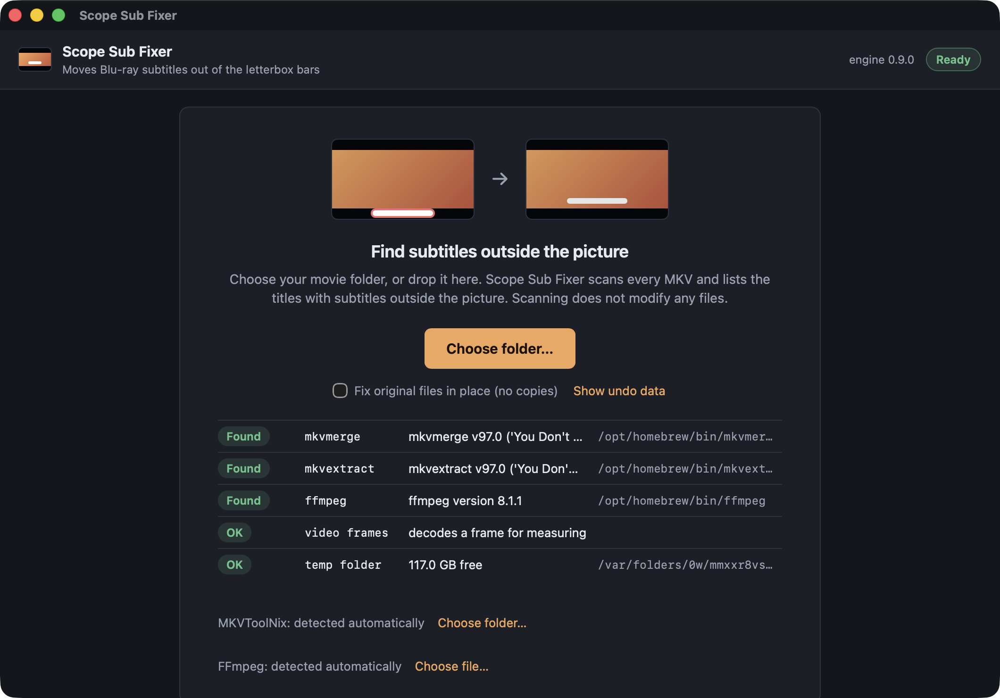
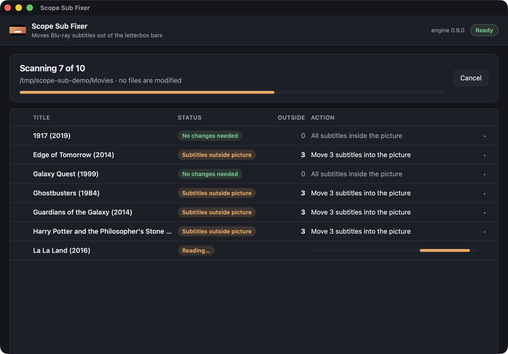
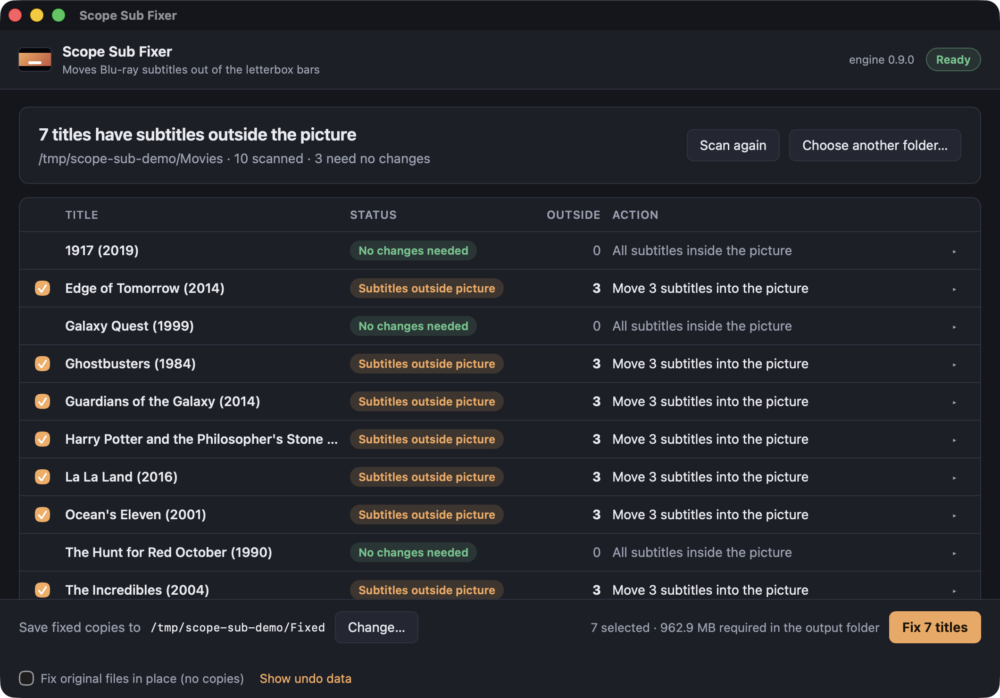
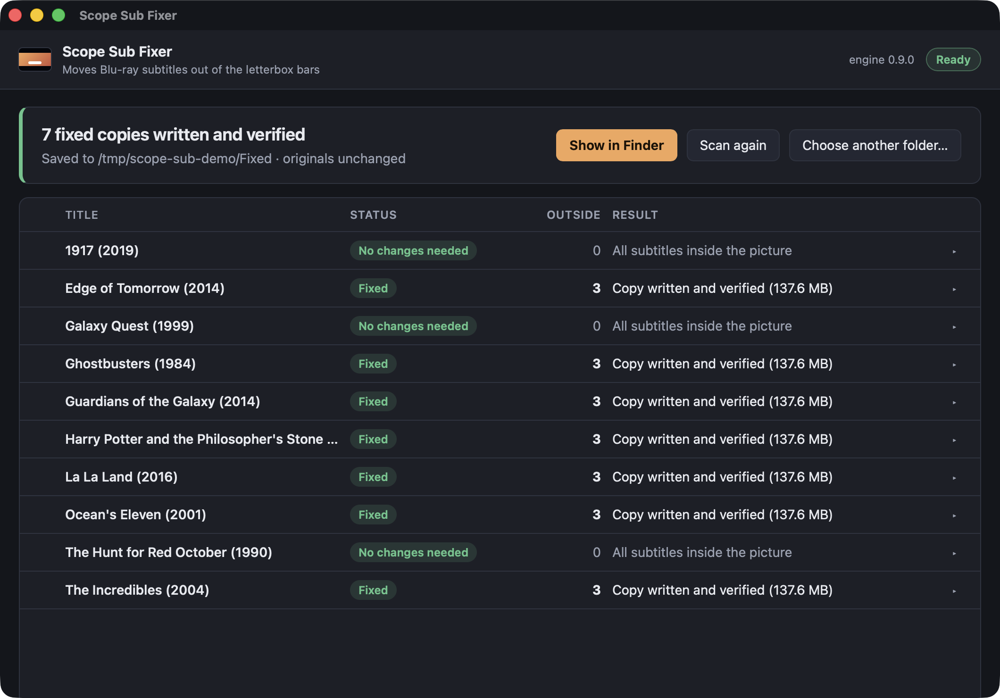

# Scope Sub Fixer: the desktop app

The desktop app is `scope-sub` for people who do not use a terminal. Choose a
folder of MKV files, see which titles have Blu-ray subtitles in the letterbox
bars, select the ones to fix, and get verified, fixed **copies** in a folder
you choose. The original files are not changed unless you turn on "Fix original
files in place (no copies)". That setting is off by default and shows a warning
first. See [Fixing the original files in place](#fixing-the-original-files-in-place).

The app is a [Tauri 2](https://tauri.app) shell around the engine. It does not
find or fix subtitles itself. It starts the engine as a separate process and
sends it JSON messages ([`../docs/engine-protocol.md`](../docs/engine-protocol.md)).

| | |
|---|---|
|  |  |
|  |  |

More screenshots are in [`docs/screenshots/`](docs/screenshots/): the setup
screen, a fix in progress, a cancelled scan, the warning shown before in-place
fixing is turned on, and the results of an in-place fix. The titles are real
films, each shown with a result typical of its Blu-ray. The files behind them
are synthetic.

## What it does

1. **Checks the tools** when it starts. If MKVToolNix or FFmpeg is missing or
   cannot be used, it says which, what it is for and how to install it, and
   offers "Check again". The "Ready" button in the header shows what was found,
   including whether FFmpeg can decode video frames the way the engine
   measures a film's picture.

   **"Locate…"** beside a missing tool lets you choose it yourself: the folder
   that holds mkvmerge and mkvextract, or the ffmpeg program. The choice is
   remembered, used from then on, and shown in the details as "Custom
   location: …". "Detect automatically" goes back to the automatic search. The
   same controls are in the "Ready" details, to switch to another copy of a
   tool that was found. If a chosen location does not hold a working tool, the
   setup screen comes back and says what is wrong. The app never falls back to
   other tools without saying so.
2. **Scans a folder** and its subfolders, with a live list, a progress bar and
   a Cancel button. Choose the folder with "Choose folder…", drop it on the
   window, or (on macOS) drop it on the app's icon. Scanning only reads files.
3. **Lists every title** with a plain status, such as "Subtitles outside
   picture", "No changes needed", "Cannot be fixed" or "Variable aspect ratio",
   with how many subtitles are outside the picture and what will happen. Click
   a row to see the tracks and the engine's own description.
4. **Fixes the selected titles into copies** under an output folder. Each
   title shows its progress ("Copying…", "Verifying copy…", "Verifying
   subtitles…") and the result. A title counts as fixed only after its copy has
   been read back and its subtitles checked.
5. **Rebuilds titles that cannot be fixed by changing bytes.** If a title's
   subtitle track is stored compressed (mkvmerge does this by default), the
   engine rebuilds the file with mkvmerge instead. These titles show "Rebuild
   required (slower)" and are selected like the others. Their progress shows
   "Analyzing…", "Extracting subtitles…", "Rebuilding…" and "Verifying against
   original…". They count as fixed only when every other stream of the rebuilt
   copy matches the original. All other titles are still fixed by changing
   bytes.

## Fixing the original files in place

This setting is off by default. For a library of 30–80 GB films, a second copy
of every fixed title may not be practical. With this setting the app does what
`scope-sub apply --dangerously-in-place` does: it changes the few thousand
subtitle-position bytes inside the film file itself.

**Turning it on.** The setting "Fix original files in place (no copies)" is a
checkbox on the first screen and under the Fix button. Selecting it opens a
dialog. The setting turns on only after "I understand that my original files
will be modified and no copies will be kept" is selected and "Turn on" is
pressed. "Cancel" leaves the setting off. The dialog says:

> **Fix original files in place?**
> When this is on, Scope Sub Fixer modifies your original files and does not create copies.
> - Original files are modified. No copy of the original is kept.
> - Changes can only be reversed using the undo data stored in *(the app's plans folder)*. Do not delete that folder. Back up any files you cannot replace.
> - Only subtitle positions change. Video, audio and all other data are not modified.
> - Each file is verified after it is fixed. If verification fails, the original is restored automatically.
> - Titles that require a rebuild cannot be fixed in place and are skipped. Turn this setting off to fix them as copies.
> - You can restore a file's original subtitle positions later from its row in the list.

The setting is remembered. Turning it off takes one click and no dialog.

**While it is on**, a red banner says "In-place fixing is on. Original files are
modified and no copies are made.", with "Turn off" and "Show undo data"
buttons. The footer has no output folder. The Fix button is red and reads, for
example, "Fix 5 titles in place". Every run asks again: "Fix 5 files in place?"
with "5 original files will be modified. No copies are made. Each file is
verified afterwards and restored if verification fails." Titles that require a
rebuild cannot be selected and show "Requires a copy: cannot be fixed in
place". When the setting is off, the app works as described above, with the
one extra checkbox.

**During a run** a title shows "Modifying and verifying…". Cancel does not
interrupt a title that is being changed. The banner says "Stopping after the
current title. A file being modified is always completed and verified first."

**Keeping file dates.** Fixing or restoring a file in place changes its
modification date, so a media server may list the film as new. The red banner
has a second checkbox, "Preserve file dates". It is off by default, is
remembered, and needs no dialog. It is shown only while in-place fixing is on,
but once selected it applies to every write to an original file, including a
restore or a "Finish fixing" done while in-place fixing is off.

On a network share the server can change a file's date again after the write,
so the engine watches each date for up to 150 seconds and waits for this once,
at the end of the run. During the wait the app shows "Verifying file dates… up
to N seconds. Network shares can update a file's date shortly after a change."
Cancel ends the wait during a fix. A restore has no Cancel button and waits
until the end. If a date could not be kept, the title's row says "The file's
date could not be preserved. Media servers may list it as recently added." The
fix still counts.

**Restoring.** A title fixed in place shows "Fixed in place". Its row has a
"Restore original" button. The app asks for confirmation, restores that one
title, and shows "Restored" only after the engine has read the file back and
found the original bytes. This works whether the setting is on or off.

**Interrupted writes.** If the app, the engine or the computer stops while a
film file is being changed, the next scan shows that title in red as "Fix
interrupted" (or "Restore interrupted"). Its row is opened and it cannot be
selected. It has two buttons: "Finish fixing", which completes the fix and
verifies it, and "Restore original". Either one leaves the file complete.

**Keep the undo data.** The undo data is the plan folder for the scanned
folder (see [Where things are kept](#where-things-are-kept)). The app never
deletes or rebuilds a plan folder that holds undo data. When a new version of
the app cannot use an old scan, it normally scans again from the start ("All
titles are being rescanned."). If the old scan holds undo data, the app does
not rescan. It says so and stops. "Show undo data" opens the folder in Finder,
or in Explorer on Windows.

## Where things are kept

The app's folder is `~/Library/Application Support/com.luminationlabs.scopesubfixer/`
on a Mac. On Windows it is under `%APPDATA%`.

- **Tools chosen by hand**: `tools.json` in the app's folder, for example
  `{"mkvtoolnixDir": …, "ffmpeg": …}`. It holds only the tools that were
  chosen, and does not exist when none were. The app sends the choice to the
  engine each time the engine starts. Deleting the file goes back to the
  automatic search.
- **Settings**: `settings.json` in the app's folder. It has `"inPlace": true`
  when "Fix original files in place (no copies)" is on, and `"keepDates": true`
  when "Preserve file dates" is on. A missing file, an unreadable file, or any
  value other than `true` means off.
- **Plan folders** (the scan results, the byte changes and the log):
  `plans/<folder-name>-<hash of the folder's path>/` in the app's folder. There
  is one for each scanned folder, kept between runs. This is why a second scan
  of the same folder is fast (only new or changed files are read) and why the
  app can show "Fixed (copy)" for titles fixed earlier. For titles fixed as
  copies it is not needed for undo, because the original is unchanged. **For
  titles fixed in place it is the only undo data.** It is named after the
  folder's path, so if the library is moved or renamed, the app starts a new,
  empty plan folder and the undo data stays under the old name.
- **Fixed copies**: in the output folder you choose, with the library's
  subfolders. The engine refuses an output folder inside the library.

A plan folder written by the command-line tool and one written by the app use
the same format.

## Safety

- The app writes copies unless in-place fixing is on. It sends the engine an
  in-place request only while that setting is on (or to finish an interrupted
  fix you asked to finish), and only after you answered the question for that
  run.
- The engine will not replace an original with a copy, skip verification, or
  overwrite an existing file when the app asks. A file already in the way is
  reported as "File exists".
- The app fixes exactly the selected titles.
- In place, only the titles in the plan are written, by the engine's normal
  in-place code. The app adds no other way to write a film file.
- The output folder is checked by what it is on disk, not how it is spelled. A
  symbolic link into the library, another spelling of it on a case-insensitive
  disk, or a parent folder that would put a copy among the originals is
  refused like the library itself.
- Cancel during a fix stops the title in progress at whatever stage it is in
  and deletes the unfinished copy.
- Quitting during a fix does the same: the app asks the engine to stop and
  waits up to 15 seconds for it to clean up.
- If the app or the engine is killed (a force quit, a crash, a power cut), the
  engine cannot clean up. The leftovers are removed later: the engine's temp
  folder when the engine next starts, and the unfinished copy
  (`<name>.mkv.scope-sub-partial`) the next time titles are fixed into the same
  output folder. Only files that the plan's own log shows were being written
  are removed. One case is not cleaned up: a title killed during its final
  subtitle check leaves a full-size, unchecked file under its final name. The
  next fix reports it as "File exists" and neither trusts nor deletes it.
- A fix is refused before it starts if it will not fit: the copies in the
  output folder, plus working space in the temp folder for the largest title
  that has to be rebuilt.
- The app window can only pick a folder, show a file in Finder or Explorer,
  and use the app's own commands (to talk to the engine, load and save its
  settings, and check a dropped folder). It cannot start a process and has no
  file or network access of its own.

## Limits

This is an early version.

**Distribution**
- **Signing.** A build you make yourself is ad-hoc signed, so macOS
  Gatekeeper blocks a downloaded copy of it until you allow it. The `Release`
  workflow signs the macOS app with a Developer ID and notarizes it when the
  signing secrets are set. The engine is a JavaScript runtime with a
  just-in-time compiler, and under the hardened runtime it starts only with
  the two entitlements in `src-tauri/entitlements.plist`. The Windows
  installer is not signed, so Windows shows a warning before it runs.
- **Platforms.** The app has been built and used on macOS on Apple silicon,
  and built as an installer and used by hand on Windows 11 ARM64. It has not
  been built for Intel Macs, Windows on x64 or Linux.
- **No packaged downloads.** On macOS the build is a bare `.app`, with no
  `.dmg`. There is no automatic update or version check.
- **The name, bundle identifier (`com.luminationlabs.scopesubfixer`) and icon
  are placeholders.**

**Dependencies**
- **MKVToolNix and FFmpeg are not included.** You must install them; the app
  explains how. Including them would raise licensing questions (FFmpeg is LGPL
  or GPL depending on the build) and need separate builds for each platform.
- **MKVToolNix installed from its `.dmg` may not be found** automatically. The
  search looks in `/Applications/MKVToolNix.app`, but the download installs as
  `MKVToolNix-<version>.app`. Use "Locate…" instead. The engine accepts the app
  itself as the choice. It has not been checked whether the macOS folder
  picker lets you choose an `.app`.
- **"Locate…" has not been tested by hand.** The steps after the folder picker
  have been tested automatically.

**Function**
- **The undo data is kept in the app's own folder**, named after a hash of the
  library's path. For files fixed in place it is the only way back, but it is
  not somewhere you normally see, back up, or move along with the library. The
  dialog and "Show undo data" say where it is. It should be a folder you choose;
  the command-line documentation recommends a copy beside the library.
- **An old scan that holds undo data, and that this version cannot use, blocks
  scanning that folder in the app.** The app says so, but offers no way out.
  The command line's `plan --reanalyze` keeps the entries of files it wrote, so
  a "scan again, keeping the undo data" action is possible. It has not been
  added.
- **Restoring is one title at a time**, from its row. There is no "restore
  all".
- **In the app, in-place fixing has been tested on synthetic files only**, up
  to a few hundred MB. The same engine has fixed a large library of real disc
  rips in place from the command line, over a network share.
- **There is no replace-original mode.**
- **A rebuild needs working space on the system disk.** Verifying a rebuilt copy
  extracts the streams of both files into the temp folder, one file at a time.
  This needs space about the size of the title, on top of the copy. The footer
  says how much and where, and the engine refuses a fix that will not fit. The
  temp folder is the system's and cannot be changed. Rebuilds have been tested
  only on files of a few hundred MB.
- **No estimate of time remaining.**
- **One folder at a time**, always including subfolders, with the aspect ratio
  always measured. There are no settings beyond the tool locations, in-place
  fixing and file dates.
- **No preview** of a subtitle before and after.
- **Cancel is not instant.** A frame sample already running finishes first
  (normally well under a second). Otherwise a fix stops at its current stage.
  A cancelled title leaves no file and no temp files, except possibly an empty
  title folder in the output folder.
- **The whole list is redrawn** on every change. This is fine for hundreds of
  titles but has not been checked with thousands.
- **There is no log file.** System errors are shown in plain words, so the
  exact error message is not shown.
- **Saved scans can be discarded.** When a new version cannot use a saved scan,
  the app scans the folder again from the start and shows a notice. Fixed
  copies made earlier are not affected, but their "Fixed (copy)" status is lost.
  This does not happen when the scan holds undo data (see above).

**Engineering**
- **No automated UI tests.** The protocol, the engine and the app's wording
  logic are tested (`test/serve/`). The screens are tested only by the
  autopilot run (see below).
- **`@tauri-apps/plugin-shell` is still a dependency** of the frontend, though
  nothing there imports it. The shell plugin is used from Rust only.
- **`src/protocol.ts` is a hand-kept copy** of the engine's message types.

## For developers

### Layout

```
desktop/
  index.html, src/         the frontend (Vite + TypeScript, no framework)
    main.ts                state, rendering, actions
    engine.ts              the protocol client: requests, events, cancel
    protocol.ts            the engine's message shapes, as the app uses them
    words.ts               every word the app shows, and the verdict on a
                           finished fix (pure; tested in ../test/serve/)
    autopilot.ts           the UI driving itself, for end-to-end runs
  sidecar/entry.ts         entry point of the compiled engine
  scripts/
    sidecar.mjs            builds the engine (or a dev shim) into src-tauri/binaries/
    engine-smoke.mjs       doctor → plan → apply against any engine binary
    make-fixtures.ts       a ten-title library of synthetic MKVs
    screenshots.sh         launches the built app on autopilot and captures its window
    window-id.swift        finds the window for screencapture
    engine-without-tools.mjs  the real engine, with doctor reporting the tools missing
  src-tauri/               the Rust shell: a window and the engine process
    src/settings.rs        tools.json and settings.json
    src/engine.rs          starts the engine, passes lines between it and the
                           window, and stops it when the app quits
    capabilities/default.json   what the window is allowed to do
    tauri.windows.conf.json     Windows overrides (NSIS installer)
```

### Developing

You need Rust 1.77 or newer, Node 22.12 or newer, pnpm, and
[bun](https://bun.sh) for the compiled engine. To scan anything you also need
MKVToolNix and FFmpeg.

```sh
# Once, in the repository root: build the engine for Node (the dev shim runs it)
pnpm install && pnpm build

cd desktop
pnpm install
pnpm tauri dev          # Vite on port 1420, the Rust shell, hot reload for the frontend
```

`tauri dev` runs the engine through a dev shim. `scripts/sidecar.mjs --dev`
writes a small shell script where the engine binary belongs, and that script
runs `node ../dist/cli/main.js`. After an engine change, run `pnpm build` in the
repository root and restart the app. Windows cannot start a shell script as
the engine, so there `--dev` compiles the engine with bun instead.

To make a library to try it on, from the test suite's synthetic fixtures (no
real disc material):

```sh
bun scripts/make-fixtures.ts /tmp/scope-sub-demo           # small files, quick to scan
BIG=1 bun scripts/make-fixtures.ts /tmp/scope-sub-demo 3   # ~200 MB titles, slow enough to watch
```

The second argument is the length of each title in seconds (default 8).
`SHOWCASE=1` makes the titles used in the screenshots.

Checks: `pnpm typecheck` in `desktop/`, and `pnpm typecheck && pnpm test` in
the repository root. The root test suite includes the protocol tests and the
tests of the app's wording logic (`test/serve/`).

### Building

```sh
cd desktop
pnpm tauri build
# → src-tauri/target/release/bundle/macos/Scope Sub Fixer.app   (about 60 MB)
```

`tauri build` first runs `pnpm build:web`, which compiles the engine,
type-checks and builds the frontend. On macOS the bundle target is `app` only
(no `.dmg`).

On Windows, Tauri merges `src-tauri/tauri.windows.conf.json` over
`tauri.conf.json`. The target there is `nsis`, which makes an installer under
`src-tauri/target/release/bundle/nsis/`, and the folder association (a macOS
feature for dropping a folder on the app's icon) is removed. The macOS build
reads only `tauri.conf.json`.

The `Release` GitHub workflow (`.github/workflows/release.yml`) runs for a
version tag. It builds the macOS app, the Windows installer and the
command-line package, and attaches them to a draft GitHub release. Run by
hand, it builds the same files without making a release.

A normal build ignores `SCOPE_SUB_AUTOPILOT` (see
[Screenshots](#screenshots-and-unattended-runs)). For screenshots and
unattended end-to-end runs, build with the hook included:

```sh
pnpm tauri build --features autopilot      # do not give this build to anyone
```

### How the engine binary is made

The engine is TypeScript for Node, and users will not have Node.
`scripts/sidecar.mjs` turns it into one self-contained executable:

```sh
bun build --compile --minify --target=bun-darwin-arm64 sidecar/entry.ts \
    --outfile src-tauri/binaries/scope-sub-engine-aarch64-apple-darwin
```

The target follows the host: the Rust host triple from `rustc -vV` (Tauri
names the engine binary after it), or Node's platform and architecture when
rustc is not available, or `--target=<triple>`. The script knows
`aarch64-apple-darwin`, `x86_64-apple-darwin`, `x86_64-unknown-linux-gnu`,
`aarch64-unknown-linux-gnu`, `x86_64-pc-windows-msvc` and
`aarch64-pc-windows-msvc` (`bun-windows-arm64` needs a recent bun). On Windows
the file name ends in `.exe`, as Tauri expects.

Tauri's `bundle.externalBin: ["binaries/scope-sub-engine"]` picks the file for
the host's target triple and copies it into the bundle as
`Scope Sub Fixer.app/Contents/MacOS/scope-sub-engine`, next to the app's own
binary. The Rust shell (`src-tauri/src/engine.rs`) starts it with exactly
`serve --stdio`, in its own process group (a job object on Windows), and
passes lines between it and the window. The window calls `engine_start`,
`engine_write` and `engine_stop` and listens for `engine` events. The window
cannot start a process itself: `capabilities/default.json` grants nothing from
the shell plugin.

The shell owns the engine process so that it can stop it cleanly. When the app
quits (the Quit menu, or the last window closing), it sends the engine
`shutdown`, waits up to 15 seconds for it to exit, and then kills what is left
of its process group. `shutdown` makes the engine stop a running mkvmerge or
mkvextract, delete the unfinished copy and remove its temp folder. Killing the
engine directly would leave all three.

`sidecar/entry.ts` exists because `src/cli/main.ts` runs only when it is the
script Node was started with, which a single-file executable never is. The
compiled engine is the whole command-line tool, so `scope-sub-engine doctor`
works in a terminal.

**Why bun instead of a Node single-executable application (SEA).**
`bun build --compile` is one command with no extra dependencies. It bundles the
TypeScript directly, signs the result ad hoc, and can build for other
platforms from a Mac (`bun-windows-x64`, `bun-linux-x64`, and so on). A Node SEA
needs a separate step to bundle to CommonJS, a blob, an injection tool,
re-signing, and an official Node binary for each platform. Both produce files
of similar size.

**The cost: the engine runs on bun, and its tests run on Node.**
`scripts/engine-smoke.mjs`, run against the compiled engine and against
`node dist/cli/main.js` with the same fixtures, gives the same results, the
same patch files and identical fixed copies. One known difference is that bun
reports file modification times in whole milliseconds and Node reports
fractions. The engine compares times to within a millisecond, so plan folders
written by either can be used by the other.

### Trying the engine without the app

```sh
pnpm sidecar                                   # compile the engine
node scripts/engine-smoke.mjs /tmp/scope-sub-demo/Movies /tmp/scope-sub-work
node scripts/engine-smoke.mjs /tmp/scope-sub-demo/Movies /tmp/scope-sub-work2 node ../dist/cli/main.js
```

The second form runs the same steps against the Node build, for comparison.

### Screenshots and unattended runs

Nothing outside the app can click a native folder picker, so the app can drive
itself. When it is started with `SCOPE_SUB_AUTOPILOT` set to a JSON script
(`src/autopilot.ts`), it scans the folder named there and fixes into the
output folder named there, by calling the same functions the buttons call.

The hook is included in debug builds (`pnpm tauri dev`) and in builds made with
`--features autopilot`. A normal release build ignores the variable.
`scripts/screenshots.sh` therefore needs a build with the hook:

```sh
pnpm tauri build --features autopilot
```

```sh
WORK=/tmp/scope-sub-demo SHOWCASE=1 BIG=1 FIXTURE_SECONDS=2 \
  scripts/screenshots.sh /tmp/scope-sub-frames '"showTools":true'
```

This builds a fixture library, starts the built app, and saves a frame of its
window several times a second. Whatever runs it needs Screen Recording
permission. The window must stay visible during the run: a covered window is
not redrawn, so the frames stop changing even though the app keeps working.

The second argument adds keys to the autopilot script:

| Key | What it does |
| --- | --- |
| `"cancelFixAt":"rebuild"` | Presses Cancel when a title reaches that stage. |
| `"quitFixAt":"rebuild"` | Quits the app at that stage, the way the Quit menu item does, to check what a quit during a fix leaves behind. |
| `"inPlace":true` | Turns on "Fix original files in place (no copies)" through its dialog and fixes the library **in place**. The library is changed: use fixtures only, never real media. |
| `"undoFirst":true` | With `inPlace`: restores the first fixed title afterwards. |
| `"tools":{"mkvtoolnix":"/some/folder"}` | Chooses a tool by hand first, as "Locate…" does after the picker returns (`""` goes back to the automatic search). Without a `library` the run stops there. |

The setup screenshot is simulated, because the tools are installed on the
machine that took it. A copy of the built app had its engine replaced by a
shim that runs `scripts/engine-without-tools.mjs`: the real engine, with
`doctor` reporting MKVToolNix and FFmpeg missing. The text on that screen is
the engine's real output for that case.
